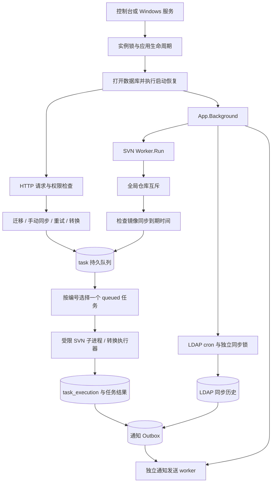
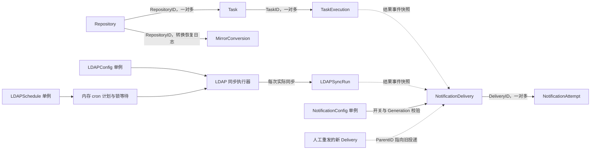
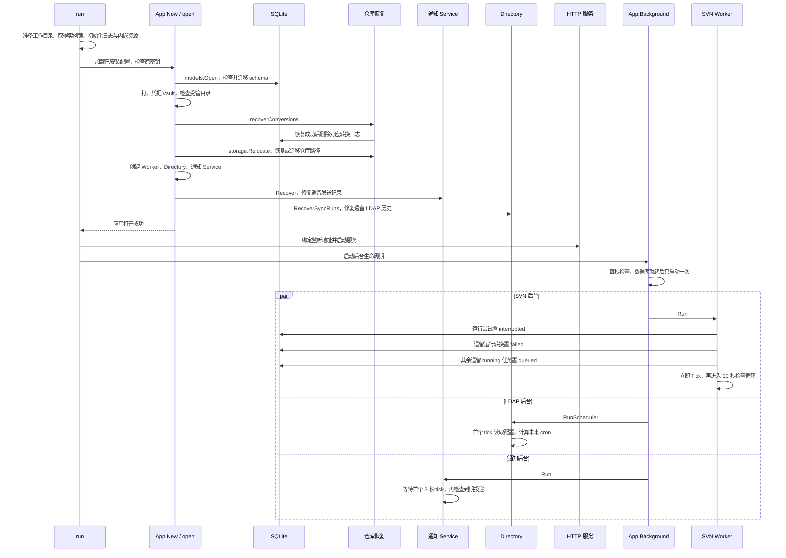
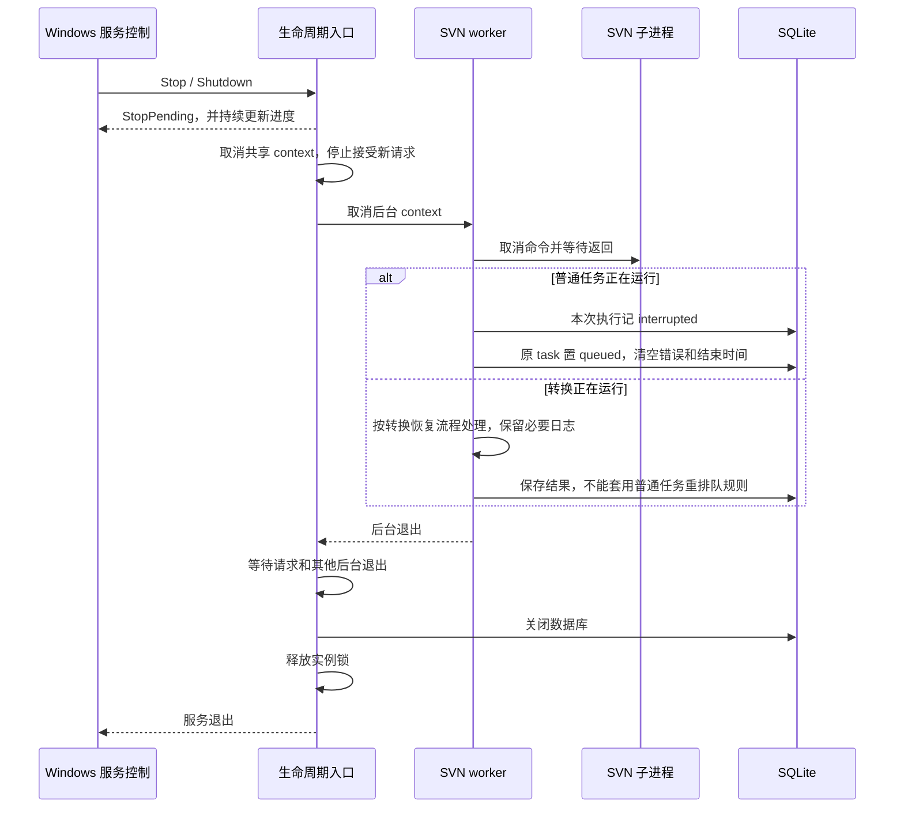
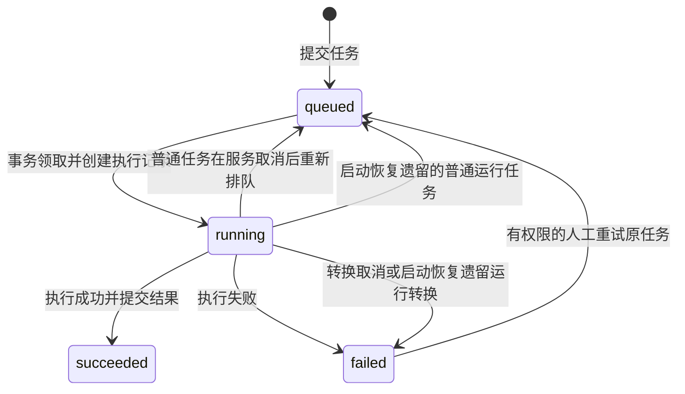
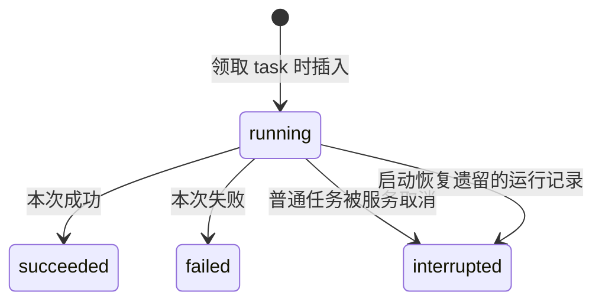
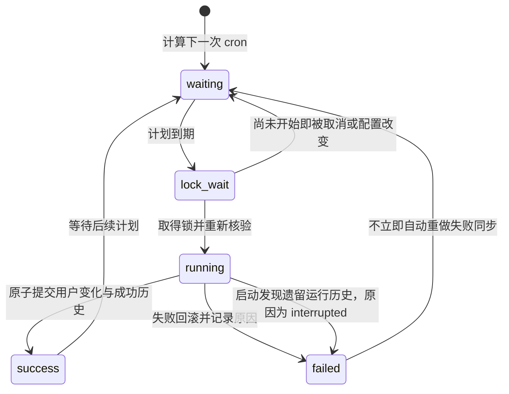
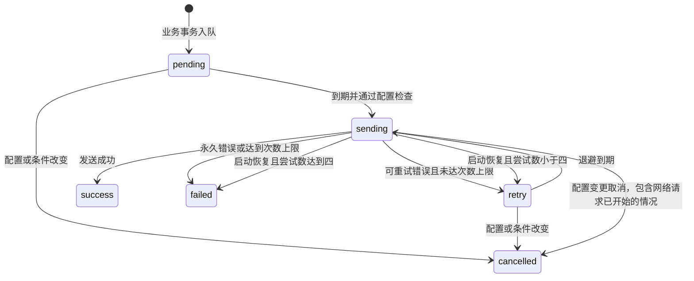
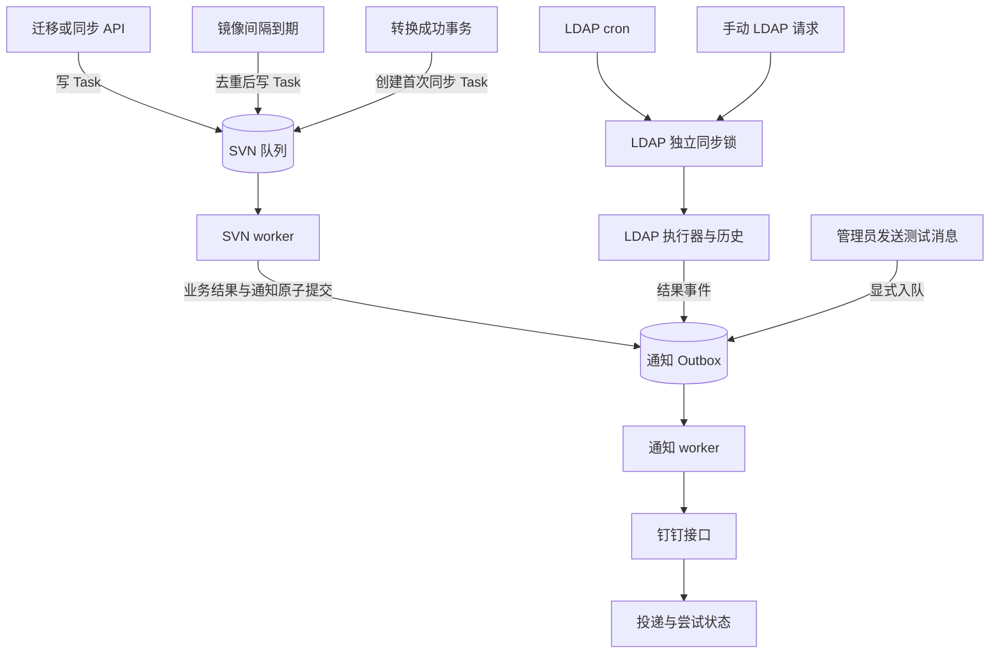

# 后台任务运行机制

本文覆盖 SVN 仓库任务、LDAP 同步和通知投递，说明模型、worker、生命周期、执行流水线、状态跃迁、协作与并发控制，并提供排障和源码入口。验收边界见[验收与限制](acceptance.md)。

> 本文必须与实现同步。新增、删除或修改调度入口、轮询节奏、单轮处理范围、锁、模型／状态／时间字段、重试、恢复或退出流程时，必须在同一变更中更新本文、相关 Mermaid 图、源码索引和对应测试／主题文档。本文不是固定版本快照或开发流水。

## 1. 总体模型

应用为单实例，SQLite 保存任务与执行记录；没有外部消息队列，也没有多 worker 并行执行仓库任务。

### 模型、worker 和任务类型

- **模型**保存配置、待办状态、执行历史或恢复信息；一张表不等于一个 worker。
- **worker／调度循环**发现待办并调用业务执行器。SVN 的四种 `kind` 共用一个 Worker，不是四个 worker。
- **触发器**决定何时产生工作：API 请求、镜像间隔到期、LDAP cron 或业务结果写入 Outbox。
- **执行尝试**记录一次实际处理；逻辑任务／投递与尝试分开，便于追踪重试和中断。

| 调度域 | 配置／业务对象 | 待办或逻辑任务 | 执行记录 | 执行者 |
| --- | --- | --- | --- | --- |
| SVN | `Repository`：间隔、NextSync、状态、Halted | `Task`：四类仓库任务共用持久队列 | `TaskExecution`：每次领取新建 | `tasks.Worker.Run / Tick` |
| LDAP | `LDAPConfig` 单例 + `LDAPSchedule` 单例 | cron 下一次时刻及等锁状态在内存；手动请求直接尝试拿锁 | `LDAPSyncRun`：实际同步历史，不是待执行队列 | `Directory.RunScheduler → ScheduledSync → syncLocked`；手动 `SyncAs → syncLocked` |
| 通知 | `NotificationConfig` 单例：开关、凭据、代次、保留期 | `NotificationDelivery`：待发／重试 Outbox | `NotificationAttempt`：每次发送尝试 | `notifications.Service.Run / Tick` |
| 转换恢复 | `Repository` + `MirrorConversion` | `MirrorConversion` 是恢复日志，不是额外任务队列 | 转换仍使用 `TaskExecution` | 启动恢复或转换失败恢复；正常转换由 SVN worker 执行 |

图中虚线为事件快照或关联重发。通知 Payload 中的执行／运行信息用于结果关联，不表示通知 worker 重新执行来源业务，也不表示所有结果必定产生通知：仍受类别、开关和过滤条件控制。ID 关系描述代码中的关联，不额外承诺数据库外键约束。

### 持久状态与内存计划

| 数据 | 保存位置 | 重启后的事实来源 |
| --- | --- | --- |
| SVN 排队任务、执行快照、镜像 NextSync | SQLite | 修复遗留状态后按 task 队列及仓库到期条件处理 |
| LDAP cron 表达式 | SQLite | 从当前时间重新计算下一次计划 |
| LDAP 下一次时刻、等待锁的计划 | 进程内存 | 不恢复旧计划，不补跑停机错过时刻 |
| LDAP 实际同步历史 | SQLite | 遗留 running 标为失败，原因为 interrupted |
| 通知队列、尝试数、NextAttempt | SQLite | 按持久退避和恢复结果继续发送 |

SVN `Task` 的 Started／Finished 使用 Unix 秒；`TaskExecution`、`LDAPSyncRun` 以及通知投递／尝试的时间使用 Unix 毫秒。不要直接跨模型相减或复用状态枚举。

## 2. 启动、停止与运行器

1. 取得工作目录实例锁，加载配置、日志和内嵌工具。
2. 已安装实例打开 SQLite、密钥和受管目录，先恢复转换日志，再处理仓库路径迁移。
3. 创建 SVN Worker、Directory 和通知 Service；恢复遗留通知发送状态、LDAP 运行历史。
4. 开放 HTTP 并启动 `App.Background`；它每秒检查是否已安装就绪，随后只启动一次三组后台服务。
5. SVN Worker 先修复遗留运行状态，再立即 Tick；LDAP 先计算未来 cron；通知等待第一个 3 秒 tick。

未安装实例的 HTTP 用于安装，后台服务须等数据库就绪。转换恢复失败可在开放正常业务前阻止启动。

`App.Background` 是生命周期组装器，不是第四个业务 worker。LDAP 调度器会为一次计划执行启动 goroutine，SVN 会启动进度采样 goroutine，HTTP 请求也可执行手动 LDAP 同步。**三组后台服务不等于进程只有三个 goroutine**。

当前没有统一任务注册表、通用 runner、全局 `JOBS_ENABLED` 或 `kick` 机制。API 将 SVN／通知待办写库，由对应轮询发现；LDAP 手动请求直接进入独立同步锁，不能把三套机制描述为同一种持久队列。

### 已安装实例的启动与恢复流程

恢复分为两个阶段：**开放 HTTP 前的应用恢复**，以及 **HTTP 开放后的 worker 启动修复**。三组后台服务并发启动，没有“全部 worker 修复完成后才接受 HTTP”的统一就绪屏障。

以下时序图展示已安装实例的成功路径；开放 HTTP 前任一步骤返回错误时，会立即终止启动，不继续后面的步骤。

#### 各类遗留数据如何恢复

| 遗留数据／检查 | 处理位置及动作 | 是否阻止开放 HTTP |
| --- | --- | --- |
| 原密钥缺失、数据库／schema／受管目录异常 | `App.New / open` 返回错误；不能另建密钥替代原密钥 | 是 |
| `MirrorConversion` 恢复日志 | 先核验本地仓库及路径，再使用快照恢复 r0／受控钩子；每条恢复使用独立的 1 分钟上下文，成功后删除日志 | 恢复失败则是，保留未恢复日志与仓库副本 |
| 仓库路径迁移／恢复 | 转换恢复之后执行 `storage.Relocate`，按持久迁移记录及目录标记检查和恢复 | 失败则是 |
| 通知遗留 `sending` 尝试 | `Notifications.Recover` 在事务中改为 `interrupted`，记录送达未知 | 事务失败则是 |
| 通知遗留 `sending` 投递 | 同一恢复事务中，Attempts 小于 4 改为 `retry`；按已有尝试数从恢复时刻安排 1／5／15 分钟退避；达到 4 次改为 `failed` | 事务失败则是 |
| LDAP 遗留 `running` 历史 | `RecoverSyncRuns` 改为 `failed`、FailureReason 为 `interrupted`，并在事务中按配置写入结果通知；不自动重做同步 | 失败则是 |
| SVN 遗留 `running` 执行记录 | `Worker.Run` 启动时置 `interrupted`，补结束时间 | 否，发生在后台启动阶段 |
| SVN 遗留 `running` 转换任务 | 在重新排队普通任务之前置 `failed`，保存需人工重试的错误和结束时间 | 否，需人工重试转换 |
| 其余 SVN 遗留 `running` 任务 | 重新置 `queued`；原本已排队的任务保持排队，后续按编号领取 | 否，自动再尝试 |
| LDAP cron 内存计划 | 不恢复旧 next／等锁计划，重新计算当前时刻之后的下一次执行 | 否，不补跑停机计划 |
| 通知原有 `pending`／`retry` | 保留原队列及 NextAttempt，发送 worker 按到期时间继续处理 | 否，启动不立即批量发送 |

当前 `Worker.Run` 的三次遗留状态更新忽略返回错误，不能将它们理解为已经通过校验的启动关卡；数据库异常时不能仅凭 HTTP 已可访问就断言这些状态修复成功。相比之下，`open` 中的转换、路径、通知和 LDAP 恢复错误会向上传播并阻止启动。

如果首次安装尚未完成，`App.New` 返回数据库未打开的应用，只提供安装入口；`App.Background` 等待数据库就绪，不执行上述 worker 工作。完成安装后，由后台检查启动三组服务。

### 正常停止流程

### 各类任务的停止行为

| 停止时的情况 | 停止／重启后的行为 |
| --- | --- |
| SVN 任务仍在排队 | 队列保留在数据库，重启后按编号领取 |
| 普通 SVN 任务执行中，正常取消 | 本次尝试记中断，原任务重新排队；重启后自动再尝试 |
| 进程异常退出，普通任务遗留 `running` | 启动时将运行尝试记中断、普通任务重新排队 |
| 转换执行中或遗留恢复日志 | 按恢复日志复原受控修改；恢复失败保留日志并可能拒绝启动；遗留运行转换标失败，需人工重试 |
| LDAP 定时触发正在等待独立锁 | 等待可被取消；这不是持久任务队列，重启不补跑该次计划 |
| LDAP 已进入实际同步 | 当前实现不把停止 context 传入 `syncLocked`；停止会等待其返回，LDAP 连接有各自超时，不能承诺立即取消 |
| 通知等待投递／重试 | 持久记录保留，重启继续按到期时间处理 |
| 通知发送中发生异常退出 | 尝试标中断，投递按次数恢复为重试或失败，可能重复送达 |

正常停止会取消命令，而不是等待整次同步自然完成。已完成的仓库修订不会主动回滚或删除；自动再次尝试会重新检查本地／远端身份和实际进度，不承诺恢复同一条命令的内存状态，也不保证所有迁移阶段原地续传。

HTTP 优雅关闭期限为 15 秒，超时后关闭 HTTP 连接，但仍等待请求清理和后台退出；这不是整个服务 15 秒后强制结束。Windows 服务使用 `StopPending`，初始等待提示为 30 秒，每 5 秒更新检查点，也不是硬性 30 秒退出上限。

升级时应正常停止，确认服务为 **Stopped** 且进程退出，再备份和替换 EXE；使用原工作目录和密钥启动。不要以页面失联代替进程退出确认。真实断电、磁盘满等验收边界仍以[验收与限制](acceptance.md)为准。

## 3. 调度清单

| 子系统 | 驱动方式 | 并发和持久化 |
| --- | --- | --- |
| SVN 仓库任务 | Worker 启动后立即检查，之后由 10 秒 ticker 驱动 | 全站仓库操作串行；`task` 队列、`task_execution` 执行快照 |
| LDAP 同步 | 每秒检查北京时间五字段 cron；手动同步另有入口 | 独立同步锁；等待计划保存在内存，实际执行保存历史 |
| 通知投递 | 每 3 秒尝试处理一个到期投递 | 独立串行发送；持久 Outbox 与投递尝试 |
| 仓库大小统计 | 成功任务后更新；无排队任务时补算一个未知大小仓库 | 共用仓库互斥，不改变业务任务结果 |

`App.Background` 每秒检查应用是否已安装并就绪，后台服务组只启动一次。10 秒、3 秒均为检查节奏，不是开始时间或完成时间保证：执行过程、全局互斥、恢复日志及积压任务都会影响调度。长任务执行期间不会并行启动另一个 SVN 任务；ticker 不为每个错过时刻建立任务副本。

后台服务在 `services/app/app.go` 的 `Background` 中组装，不采用动态注册。

| 执行者／附属处理 | 首次动作与单轮范围 | 等待或恢复方式 |
| --- | --- | --- |
| SVN `Worker.Run / Tick` | 启动恢复后立即检查；尝试为全部到期镜像入队，再执行一个 queued | 普通取消重新排队；转换另走恢复规则 |
| `Directory.RunScheduler` | 初始化只计算未来 cron；最多保留一个计划执行／锁等待 | 定时等锁，手动遇忙报错；停机不补跑计划 |
| 通知 `Service.Run / Tick` | 等待首个 3 秒 tick；每轮最多处理一个到期投递，取消不合格记录也会结束本轮 | 持久退避，最多四次实际发送尝试 |
| Worker 大小统计 | 成功后更新；无 queued 时补算一个未知大小仓库；单次扫描上限 30 秒 | 失败至少 5 分钟后再补算，共用 SVN 锁 |
| 通知保留清理 | 发送循环首次 tick 可检查，此后约每小时检查 | 附属于通知 worker，不是第四个循环 |
| 转换／路径／遗留历史恢复 | 应用打开或 worker 启动阶段处理当前遗留记录 | 是启动步骤，不是周期调度 |

LDAP 的实际业务时间由 cron 决定，SVN 由 Interval／NextSync 决定，通知由 NextAttempt 决定；检查节奏和业务计划必须分开理解。

## 4. SVN 仓库任务主流水线

| 类型 | `kind` | 触发与用途 |
| --- | --- | --- |
| 本地迁移 | `local` | 管理员提交本地源迁入 |
| 镜像迁移 | `mirror` | 提交远端仓库首次迁移 |
| 镜像同步 | `sync` | 手动、间隔到期，或转换成功后提交首次同步 |
| 转换镜像 | `conversion` | 管理员／Owners 提交本地仓库快速转换 |

`trigger` 保存触发来源，例如 `manual`、`scheduled`、`migration`；它不表示不同优先级。转换成功后创建的首次同步当前记为 `manual`。

### 每次 Tick 的处理顺序

1. 取得全局仓库锁；若上下文已取消或存在转换恢复日志，则结束本轮。
2. 查找 `kind=mirror`、`status=ready`、`halted=false`、`interval>0` 且 `next_sync<=当前时间` 的仓库，尝试创建 `scheduled` 同步任务。
3. 按 `task.id` 升序选择一个 `queued` 任务；没有任务时尝试补算一个未知仓库大小。
4. 在事务中将任务从 `queued` 改为 `running`，同时插入本次 `task_execution`。条件更新未命中时不继续执行。
5. 检查受管路径，调用本地迁移、镜像同步或转换执行器。阶段和进度在执行中更新。
6. 保存成功／失败结果；符合通知条件时，将 Outbox 与业务结果在同一事务提交。成功后更新大小缓存。

按编号排序不是“按最近入队时间排序”：人工重试保留原任务编号，旧任务重试后可能排在新任务前面。当前没有优先级、并发数设置或用户取消单个排队任务的入口。

### 镜像间隔规则

- 镜像采用秒数间隔，不是 LDAP 的 cron。`interval=0` 关闭定时同步。
- 普通镜像迁移／同步正常结束（包括失败）后，若间隔启用，按“本次结束时间 + interval”更新 `next_sync`；不是固定整点计划。
- 同一仓库已有活动任务时，到期检查不会创建重复任务。停机期间不会为每个错过间隔补建记录；重启后再次检查到期条件。
- 转换成功事务同时更新仓库镜像配置、创建首次同步、保存成功执行快照并删除恢复日志。
- 已就绪镜像的一次普通同步失败不清空仓库；在仓库未被停用同步且仍符合到期条件时，后续定时检查可以创建新的同步任务。这与“重试原失败任务”是两回事。

### 逻辑任务与执行尝试

#### `task`：逻辑任务的当前状态

这里的“普通任务”指 `local`、`mirror`、`sync`，不含 `conversion`。当前 Worker 用 `queued` 表示需要重新执行的普通任务，并不把它永久停留在 `interrupted`；“已中断”主要记录在执行历史中。

人工重试要求仓库管理权限，无活动任务、无完整性停用状态，并能取得仓库锁；本地迁移还要求管理员身份。转换重试要求仓库仍为就绪本地仓库，并更新操作者身份；执行开始和提交配置前还会重新核验操作者权限。重试入口选择该仓库编号最大的失败任务，沿用编号、清空错误和结束时间，触发方式改为 `manual`，不删除旧执行记录。

#### `task_execution`：每一次实际尝试

实际执行中的转换取消通常进入失败处理和恢复，不能一概视为普通同步的自动重新排队。异常退出遗留的运行执行记录由启动恢复标为 `interrupted`。

| 数据 | 含义与时间单位 |
| --- | --- |
| `task.ID` | 逻辑任务编号；人工重试沿用 |
| `task.State`、`Phase` | 当前状态与执行阶段；阶段不是独立状态机 |
| `task.Started`、`Finished` | Unix 秒；`Started` 入队时写入，实际开始时重写，不能作为稳定创建时间 |
| `task_execution.ID` | 每次领取新建，不因人工重试覆盖 |
| 执行 `Started`、`Finished` | Unix 毫秒；用于实际尝试耗时 |
| `BeforeRevision`、`AfterRevision`、`RevisionKnown` | 修订快照；只有可靠成功快照才能计算新增修订，不从当前仓库 HEAD 补算旧执行 |
| 仓库 `Status`、`Halted`、`LastSuccess` | 与任务状态独立；任务失败不等于已有仓库不可读，也不更新最近成功时间 |

仓库任务表和统计按逻辑任务及最新尝试展示；首页活动按各次执行快照展示，因此数量口径可能不同。关闭浏览器或图表筛选不会取消后台任务。

### 典型阶段

| 类型 | 主要阶段 |
| --- | --- |
| 本地迁移 | 源检查与校验 → 移动或复制 → 目标校验／身份核对 → 发布 → 源清理 |
| 镜像迁移／同步 | 根地址／UUID／修订检查 → 初始化（首次迁移）→ 内容同步 → 修订属性同步 → 最终身份与修订核验 |
| 转换镜像 | 准备 → 本地与远端检查 → 恢复快照 → 初始化镜像 → 最终复核 → 原子提交；失败则执行恢复 |

普通 SVN 命令默认每条 30 分钟，本地 verify／hotcopy 默认每条 24 小时；转换使用整体可配置超时，默认 24 小时，从实际执行开始而非排队时开始。具体阶段恢复边界见[架构与恢复](architecture.md)。

## 5. LDAP 同步流水线

五字段 cron 使用北京时间，默认 `0 0 * * *`。初始化或修改计划后计算下一个未来时刻，不追补停机期间计划。等待锁期间若禁用同步、变更表达式或停止服务，会取消尚未开始的计划；实际开始前再次检查计划与启用状态。手动请求遇忙返回错误，而定时请求可以等待锁。

LDAP 历史状态使用 `running`／`success`／`failed`，启动中断以 `failed` 加 `FailureReason=interrupted` 记录；不要直接复用 SVN 的 `succeeded`／`interrupted` 文案或枚举。

## 6. 通知 Outbox 与投递流水线

业务事务只写入通知队列，不执行网络发送。发送 worker 每 3 秒最多处理一个到期投递，实际发送尝试至少间隔 3 秒；可重试错误最多尝试 4 次，三次退避依次为 1、5、15 分钟。永久错误直接失败。保存配置时会检查 `pending`、`retry` 和 `sending`，关闭通知、配置代次变更或不再符合发送条件等取消条件成立时，直接将投递置为 `cancelled`，包括已开始网络发送的投递；发送 worker 也会在发送前复查状态。人工重发产生关联的新投递，不重跑 SVN／LDAP 业务。

投递记录与发送尝试是两层状态；遗留 `sending` 尝试恢复为 `interrupted`。发送前复查发现投递已取消时，不再发起请求，并将本次尝试记为 `cancelled`。网络发送已开始后，配置变更仍可将投递置为 `cancelled`，但请求无法撤回，消息可能已送达；本次尝试保存实际发送结果，投递结果更新则带有 `status=sending` 条件，因此不会将已取消的投递重新改为成功、失败或重试。通知不保证恰好一次送达。保留清理由发送循环约每小时检查一次。

## 7. 调度之间的协作关系

- SVN 与 LDAP 可各自执行，串行限制分别作用于本调度域；它们共享数据库，但不共用业务锁。
- 来源业务只在本地事务中写 Outbox，不同步等待钉钉网络调用；通知失败不会重跑仓库或 LDAP 同步。
- 转换成功创建的是后续同步任务，不是在转换内部继续执行一次完整同步。
- 没有 `kick` 加速；持久待办由下一次对应轮询发现。通知投递失败与来源业务失败必须分开排查。

## 8. 并发与一致性

- `Worker.Tick` 持有全局仓库锁，直到本次任务及相关大小统计处理结束。
- 迁移、同步、转换、仓库设置和大小统计共用此锁，因此另一仓库的操作也可能使设置保存／重试返回忙。
- 新任务入队另有事务内的活动任务检查；同一仓库已有 `queued` 或 `running` 时拒绝重复入队。
- 遗留 `mirror_conversion` 恢复日志会阻止普通仓库任务继续执行。LDAP 和通知有各自的锁／worker，不占用这把仓库锁。

| 层级 | 机制 | 保护范围 |
| --- | --- | --- |
| 应用实例 | 工作目录实例锁 | 同一工作目录只有一个进程，不支持分布式多实例调度 |
| 仓库操作 | Worker.mu 与转换恢复日志检查 | 全站仓库变更、转换、设置和大小统计互斥 |
| SVN 重复入队 | SQLite 写锁 + 同仓库 queued／running 检查 | 手动／定时入口不会同时新增同仓库活动任务 |
| SVN 领取 | 条件更新 queued → running + 插入执行记录的事务 | 未领取成功不运行，逻辑任务与本次执行关联 |
| LDAP | 独立锁 + 拿锁后核验计划／配置 | 手动、定时同步与相关配置变更协调 |
| 业务结果与通知 | 结果提交与 Outbox 共用事务 | 避免业务提交后单独入队失败而漏写通知 |
| 通知去重与取消 | 唯一 EventKey、配置 Generation、带 sending 条件的结果更新 | 去重事件入队，避免在途结果重新激活已取消投递 |

进程内锁以单实例为前提，不能据此增加第二个部署实例。通知不承诺恰好一次。普通任务的取消重排队与转换恢复保留可用副本，但不表示所有步骤均可无条件重放；目标／staging 冲突或恢复日志异常须先核查，不能直接删除后重试。

## 9. 排障检查表

### SVN 定时同步没有开始

- 服务是否运行，仓库是否 mirror／ready、Halted 是否为 false、Interval 是否大于 0，NextSync 是否到期。
- 同仓库是否已有 queued／running；全站是否正执行另一个仓库任务或大小统计。
- 是否存在 MirrorConversion 恢复日志；运行日志是否报告恢复失败或数据库错误。
- 不要只看浏览器是否刷新：HTTP 页面刷新不驱动后台调度。

### 任务一直排队或失败后没有继续

- 查看更小编号的排队／运行任务；旧编号人工重试会重新排到前面。
- 检查 Phase、状态、错误概要和日志；进度更新时间不是子进程心跳。
- 普通失败不立即重试原 Task；人工重试沿用编号，后续定时同步可能创建新 Task。
- 转换遗留失败须人工重试；Halted 仓库先处理完整性问题，不要删除恢复日志或唯一副本。

### LDAP cron 没有运行

- 认证／同步是否启用，五字段表达式是否有效且有未来触发点，是否按北京时间理解。
- 手动同步或配置操作是否占用 LDAP 锁；定时计划是否在等锁期间被修改或停止取消。
- LDAPSchedule 保存计划，LDAPSyncRun 仅保存实际历史；没有历史不等于存在持久 queued。
- 启动只计算未来计划，不补跑停机错过时刻。

### 通知没有送达或重复送达

- 检查开关、类别过滤、凭据完整性、配置代次和测试消息规则。
- 查 NotificationDelivery 的 Status、Attempts、NextAttempt、LastError，以及对应 NotificationAttempt。
- 区分 pending／retry 未到期、永久 failed、配置改变 cancelled，以及服务中断后的送达不确定性。`cancelled` 不证明消息未送达：在途请求可能完成，应同时查看对应发送尝试。
- SVN／LDAP 成功不代表通知成功；投递重试／人工重发不重跑来源业务。

### 服务停止耗时较长

- 检查 SVN 子进程清理、转换恢复、HTTP 请求或已开始的 LDAP 同步是否仍未返回。
- 15 秒是 HTTP 优雅关闭期限，StopPending 的 30 秒为等待提示，都不是整个进程的硬退出上限。
- 确认 Stopped 且进程退出再替换 EXE，不以浏览器失联或单次停止命令返回作为退出证明。

## 10. 代码位置与维护要求

下列链接指向行为来源，函数名比提交号或固定行号更适合长期追踪；本文不绑定某次发布快照。

| 行为 | 源码入口 |
| --- | --- |
| 单实例、共享取消、HTTP 与后台退出 | [main.go](../main.go)：`run`、`serveUntilStopped`；[service_windows.go](../service_windows.go)：`service.Execute` |
| 启动恢复顺序与后台组装 | [app.go](../services/app/app.go)：`open`、`Background` |
| 仓库入队、活动任务去重 | [models.go](../models/models.go)：`EnqueueTriggered` |
| 扫描到期仓库、领取、执行及恢复 | [worker.go](../services/tasks/worker.go)：`Run`、`Tick`、`startExecution`、`finish` |
| 人工重试和同步间隔配置 | [api.go](../services/app/api.go)：`repositories`、镜像设置处理 |
| 转换恢复与原子发布 | [conversion.go](../services/app/conversion.go)：`recoverConversions`、`executeConversion` |
| SVN 进程取消与超时 | [svn.go](../services/svn/svn.go)：命令执行封装；[size.go](../services/tasks/size.go)：大小统计 |
| LDAP cron、锁和历史 | [schedule.go](../services/directory/schedule.go)、[ldap.go](../services/directory/ldap.go)、[sync_history.go](../services/directory/sync_history.go) |
| 通知入队、重试和恢复 | [events.go](../services/notifications/events.go)、[worker.go](../services/notifications/worker.go) |
| 状态和时间字段 | [models.go](../models/models.go)、[ldap_schedule.go](../models/ldap_schedule.go)、[notifications.go](../models/notifications.go) |

维护时必须核对：触发入口与检查节奏、全局／独立锁、去重与选取顺序、状态及时间单位、正常取消与异常恢复、人工重试与自动新任务的差别。涉及任一项时，同步修改本文对应表格／Mermaid 图，并更新相关功能、接口、部署和验收说明；不追加开发流水，不把计划或模拟结果写成生产保证。

回归应按变更选择已有测试：根包生命周期测试、`services/tasks` 迁移／恢复和转换测试、`services/directory` cron／锁／历史测试、`services/notifications` 重试／恢复／事务测试及 `services/app` 相关授权测试。真实 SVN 用例须设置 `SVN_BIN`，实际环境验收与自动化检查分开记录；统一命令见[贡献指南](../CONTRIBUTING.md)。
